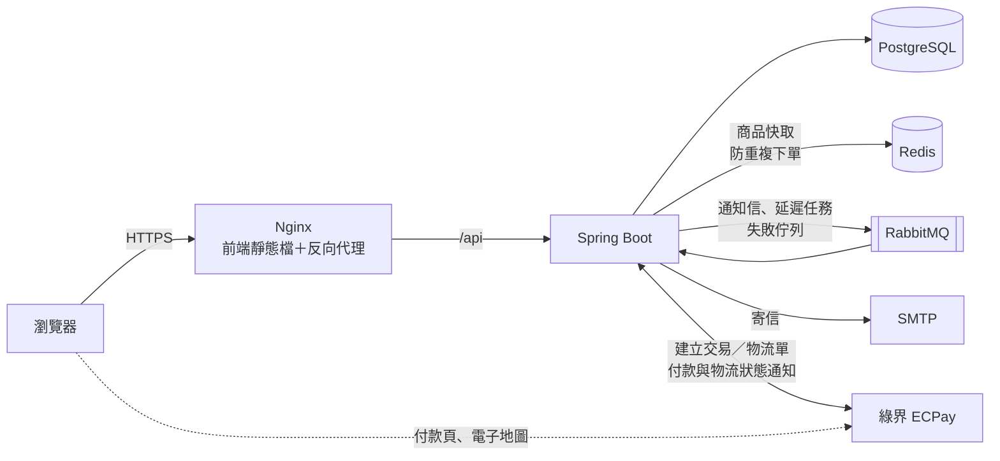

# mamaShop

家人實際要用的電商網站：前台給顧客逛商品、下單、付款，後台給家人管理商品與訂單。同時是我的後端作品集。

## 展示站

**<https://mamashop-demo.vercel.app>**

| 帳號（一般顧客） | 密碼 |
|---|---|
| `test001@example.com` | `abcd1234` |

- ⏳ **免費主機，閒置後第一次打開要等約 2～3 分鐘**：畫面若顯示「伺服器暫時無法使用」，稍等後重新整理即可
- 展示站關閉了部分功能（通知信、線上付款、快取等），商品圖片會在重新部署後消失，詳見[展示站的限制](docs/deploy/DEMO-vercel-render-neon.md#展示站和正式站的差別先知道限制)
- 後台（`/admin`）的帳號不公開，需要的話請聯絡我
- 這是公開的展示帳號，請不要在展示站輸入真實的個人資料

> 🚧 **正式站**（給家人實際使用）：功能開發完成，尚未部署上線（主機、網域還沒準備）。完整的任務清單與進度見 [`docs/PLAN.md`](docs/PLAN.md)。
> 正式站的實際使用情況：上線後補上。
>
> 部署方式有兩種，用的是同一份程式：**正式站**跑在自己的 Linux 主機（[`docs/deploy/`](docs/deploy/) 的 D01～D08）；**免費的展示站**用 Vercel＋Render＋Neon（[操作指南與限制](docs/deploy/DEMO-vercel-render-neon.md)）。

## 功能

| | |
|---|---|
| **前台** | 商品瀏覽與搜尋、購物車、會員註冊登入、結帳（宅配／超商取貨、貨到付款／信用卡線上付款）、我的訂單、手機版面 |
| **後台** | 商品與分類管理（含圖片上傳）、運費設定、訂單處理（確認、出貨、送達、完成、取消、退回、退款紀錄）、首頁概覽、管理員帳號 |
| **自動處理** | 訂單通知信、線上付款逾時自動取消並歸還庫存、宅配送達 7 天自動完成、超商物流狀態自動更新訂單 |

## 架構



正式環境用 Docker Compose 跑在一台 Linux 主機上，對外只開 Nginx；資料庫、Redis、RabbitMQ、後端都只在 Docker 內部網路。

## 技術棧與選擇理由

| 層 | 選擇 | 為什麼 |
|---|---|---|
| 後端 | Java 21、Spring Boot 4、Spring Data JPA、Spring Security＋JWT | 我原本的背景是 Spring MVC＋外部 Tomcat，這個專案用來補上 Spring Boot 的做法；4.x 是因為 3.x 的開源支援已結束 |
| 資料庫 | PostgreSQL、Flyway | Schema 只透過 migration 變更，`ddl-auto=validate`：資料表長什麼樣子看得到歷史、可以重現 |
| 快取 | Redis | 商品列表與詳情快取、結帳的一次性識別碼 |
| 訊息佇列 | RabbitMQ | 寄信不拖慢下單；用 TTL＋死信佇列做延遲任務 |
| 金流與物流 | 綠界 ECPay | 信用卡線上付款、超商電子地圖選店、超商店到店物流單 |
| 前端 | Vue 3、Vite、Pinia、Element Plus | 上手門檻低；Element Plus 適合做後台 |
| 部署 | Docker Compose、Nginx、GitHub Actions | 一台小主機就能跑；PR 自動跑測試與建置 |

**誠實面對規模**：家人的小店尖峰大概每秒幾個請求，不需要 Redis 和 RabbitMQ 也跑得動。加上它們主要是為了學習，以及把「快取到底快多少」「訊息掛了會怎樣」實際量出來、試出來。

## 設計重點

每一項在 [`docs/NOTES.md`](docs/NOTES.md) 都有對應任務的完整紀錄（設計理由、和計畫不同的決定、踩到的坑、刻意沒做的）。

### 下單不會超賣（[設計說明](docs/B08-order-design.md)）

- 扣庫存用**條件更新**：`UPDATE products SET stock = stock - :qty WHERE id = :id AND stock >= :qty`，更新 0 筆就是庫存不足，整筆交易回滾
- 多個商品**依 id 排序**後再扣，避免兩張訂單交叉等待造成死結
- 併發測試（真的資料庫、多執行緒同時下單）：庫存 10、50 人同時搶 → **剛好 10 筆成功**、40 筆收到「庫存不足」、最後庫存 0
- 把程式暫時改成「先查庫存、再扣」的錯誤寫法跑同一個測試：**50 筆全部成功，超賣 5 倍**——確認測試真的抓得到問題
- 價格、商品名稱、運費在下單當下**快照**到訂單：之後改價、改運費不影響舊訂單；金額一律由後端計算，不相信前端傳來的數字

### 訂單狀態機與多人同時操作

- 狀態轉換規則集中在一個地方（`OrderStatus.canTransitionTo`），所有變更都經過同一個入口，並寫入狀態紀錄（誰、什麼時候、從什麼改成什麼）
- **後台操作用樂觀鎖**：家人可能同時在不同手機處理同一張訂單。送出時帶上畫面上的版本號，不一致就回 409 請對方重新整理（跨請求）；同一瞬間送出則由 `@Version` 擋下
- **系統的自動操作用悲觀鎖**（`SELECT ... FOR UPDATE`）：付款通知、逾時取消、物流通知沒有人可以「看到錯誤再按一次」，所以改成排隊、依最新狀態處理
- 踩到的坑：Hibernate 的一級快取會讓 `FOR UPDATE` 拿到交易裡先前讀過的舊物件。規則是「先鎖、再讀」——併發測試抓到的

### 快取：實際量出來的效果（[壓測步驟與數據](loadtest/README.md)）

同一台機器、同樣步驟（k6、正式環境設定、1000 個商品），加快取前後：

| 同時使用者 | QPS | p95 回應時間 |
|---|---|---|
| 50 | 1,386 → **2,214**（+60%） | 70.3 → **46.7 ms** |
| 100 | 1,348 → **2,365**（+75%） | 158.1 → **83.8 ms** |

- 資料庫 CPU 103% → 39%；沒有快取的關鍵字搜尋幾乎沒變（對照組），確認改善來自快取
- 商品變動時在**交易 commit 之後**清除快取；Redis 掛掉時自動改查資料庫，網站照常運作
- 下單的庫存檢查永遠在資料庫，快取裡的庫存數字過期也不會超賣

### 防重複下單

- 進入結帳頁時取得一次性識別碼，送出時放在 `Idempotency-Key`；Redis 用 Lua 腳本保證同一個識別碼只會建立一筆訂單，重送時回傳原本那筆
- Redis 掛掉時退回「只靠前端停用按鈕」，不擋住下單

### 訊息佇列：通知、延遲任務、失敗處理

- 下單、確認、出貨時寄通知信：訂單交易 **commit 之後**才送進 RabbitMQ，寄信慢或失敗都不影響下單（實測 RabbitMQ 停掉時下單仍在 41 ms 完成）
- 延遲任務用 **TTL＋死信佇列**：「線上付款 30 分鐘未付自動取消並歸還庫存」「宅配送達 7 天自動完成」。處理時再檢查一次訂單狀態，重複收到訊息也不會出錯
- 處理失敗先重試，還是失敗就移到**失敗佇列**（附上錯誤原因），不會默默消失；修好後可以整批搬回去重新處理
- 已知的缺口也寫下來：訊息送進 RabbitMQ 之前後端就當機的話通知會遺失，完全避免要用 Outbox 模式，以目前的規模沒有做

### 串接金流與物流（綠界）

- **付款結果只相信綠界伺服器的通知**，並驗證簽章（固定時間比較）；顧客瀏覽器帶回來的資料只用來導回訂單頁
- 重複通知不會重複處理；付款通知和逾時取消同時發生時結果一定一致（併發測試各跑 10 輪）
- 取消之後才付款成功：訂單維持取消（庫存已經還回去了），標記需要退款，由後台提醒人工處理
- 寫程式之前先打綠界的測試環境確認實際行為，因此發現幾件文件沒寫清楚的事：物流的簽章是 MD5（金流是 SHA-256）、收件人姓名的實際規則、OK 超商店到店已停止服務
- 金鑰一律從環境變數讀；沒有設定時網站照常運作，只是沒有線上付款與電子地圖

### 安全與個資

- 權限總表測試：列出每一支 API 該給誰用，用「未登入／顧客／管理員」三種身分逐一驗證；新增 API 卻沒加進表裡，測試就會失敗
- 顧客只查得到自己的訂單（查詢條件一定帶會員 id，別人的訂單回 404）
- 上傳圖片限制類型與大小、檔名用 UUID；後台上傳前在瀏覽器壓縮並移除 EXIF（手機照片的 GPS 位置）
- **不收銀行轉帳**：避免顧客直接匯款到家人帳戶、帳戶被詐騙集團利用
- 正式環境：資料庫與後端不對外開 port、CSP 等安全 header、Docker log 輪替、健康檢查

## 遇到的問題與解法（挑幾個）

| 問題 | 原因 | 解法 |
|---|---|---|
| 鎖住訂單後還是用舊版本號更新、失敗 | Hibernate 一級快取：同一個交易裡先讀過，`FOR UPDATE` 回傳的是舊物件 | 第一次載入就加鎖（先鎖、再讀） |
| 綠界把選好的門市送回來時被擋成 403 | 瀏覽器從綠界的頁面 POST 會帶外部的 Origin，被 CORS 檢查擋下；測試沒帶 Origin 所以沒發現 | 綠界回呼的網址不套用 CORS，並補上帶 Origin 的測試 |
| 改完庫存馬上查列表還是舊的 | Spring Cache 的 `clear()` 允許延後執行 | 改用 `invalidate()`／`evictIfPresent()` |
| 測試跑到一半資料庫回 too many clients | 每個設定不同的測試類別各有一個連線池 | 測試的連線池上限調小 |
| 加了線上付款後，管理員能手動確認還沒付款的訂單 | 新功能做完沒有回頭檢查「舊操作遇到新狀態」 | 在 Service 擋下，補上「舊操作＋新狀態」的測試 |
| 測試隔兩天自己壞掉 | 把「未來的日期」寫死在測試裡 | 改用相對於現在的時間，或注入固定的 Clock |

完整的紀錄（每個任務一段）在 [`docs/NOTES.md`](docs/NOTES.md)。

## 測試

- 後端 400 多個測試（JUnit 5、Mockito、MockMvc），整合測試用真的 PostgreSQL、Redis、RabbitMQ
- 前端 200 多個測試（Vitest＋Vue Test Utils）
- GitHub Actions 在每個 PR 跑後端測試、前端 lint／測試／建置、正式環境映像檔建置

## 還沒做的

- 上線：主機、網域、HTTPS、備份與還原測試、外部監控
- 綠界的付款與物流通知只用「模擬通知」驗證過（綠界連不到本機），上線後要用測試商店實際走一次
- 退款是到綠界後台人工處理，系統只記錄「已退款」
- 隱私權政策頁面、登入失敗次數限制、忘記密碼

## 目錄結構

```
mamaShop/
├── backend/           # Spring Boot（依業務模組分包：order、product、payment、logistics、notification…）
├── frontend/          # Vue 3（前台與後台同一個 app，用路由區分）
├── deploy/            # 正式環境：docker-compose.prod.yml、Nginx 設定、主機設定與檢查腳本
├── loadtest/          # k6 壓力測試腳本與數據
├── docs/PLAN.md       # 專案計畫與任務清單
├── docs/NOTES.md      # 每個任務的設計理由、刻意沒做的、之後要注意的事
├── docs/deploy/       # 部署操作指南（每個指令都有說明）
├── CLAUDE.md          # AI 協作規則
├── .env.example       # 環境變數範本（複製成 .env）
└── docker-compose.yml # 本機開發用
```

這個專案是和 AI（Claude Code）協作開發的：協作規則在 `CLAUDE.md`，每個任務都要求留下設計理由、驗證方式與刻意沒做的事，記在 `docs/NOTES.md`。

## 本機啟動

需要：Java 21、Docker（Maven 不用另外裝，用專案內附的 `mvnw`）

```bash
# 1. 建立本機設定檔，修改密碼並產生 JWT_SECRET（openssl rand -base64 48）
cp .env.example .env

# 2. 啟動後端需要的服務：PostgreSQL、Redis、RabbitMQ、Mailpit（本機的假寄信伺服器）
docker compose up -d db redis rabbitmq mailpit

# 3. 啟動後端（http://localhost:8080）
cd backend && ./mvnw spring-boot:run
```

後端測試需要上面第 2 步的服務在執行中：`cd backend && ./mvnw test`

`.env.example` 裡的綠界設定（`ECPAY_*`、`ECPAY_LOGISTICS_*`）是綠界**公開的測試商店**，不會真的扣款或寄件：結帳可以選「線上付款」（測試卡號 `4311-9522-2222-2222`、安全碼 `222`）、超商取貨可以用電子地圖選門市。不想用就把 `ECPAY_ENABLED`、`ECPAY_LOGISTICS_ENABLED` 改成 `false`。本機收不到綠界的付款／物流通知（綠界連不到 localhost），模擬通知的指令在 `docs/NOTES.md` 的 P01、P03。

啟動時會依 `.env` 的 `ADMIN_EMAIL`／`ADMIN_PASSWORD` 建立預設管理員（已存在則略過）。`.env` 設定 `APP_PROFILE=dev` 時會自動載入測試商品。想把本機資料庫清空重建：`docker compose down -v`（`-v` 會刪除資料庫的 volume），再重新 `docker compose up -d db redis`。Redis 是商品快取（R01），沒啟動網站也能用，但快取的測試需要它。RabbitMQ、Mailpit 是訂單通知（M01）：寄出的信在 http://localhost:8025 看（不會真的寄出），RabbitMQ 的管理介面在 http://localhost:15672。

### 用 Docker 啟動整套服務

不需要在本機裝 Java，只要 Docker：

```bash
cp .env.example .env          # 同上，修改密碼與 JWT_SECRET
docker compose up --build     # 建置後端映像檔並啟動所有服務（資料庫、Redis、RabbitMQ、Mailpit、後端）
```

- 後端：http://localhost:8080（只綁定本機）
- 上傳的商品圖片存在 Docker volume `uploads-data`，重建容器不會消失
- 改了程式碼要重新 `docker compose up --build`；開發時建議用上面的 `mvnw spring-boot:run`，比較快
- 兩種方式都用 8080 port，不要同時開

### API 文件（Swagger UI）

`.env` 設定 `API_DOCS_ENABLED=true` 後啟動後端，打開 http://localhost:8080/swagger-ui.html

1. 在「會員：註冊與登入」呼叫登入 API，複製回傳的 `accessToken`
2. 按右上角 **Authorize**，貼上 token（不用加 `Bearer`）
3. 標有鎖頭的 API 就會自動帶上 token，可以直接按 Try it out 測試

正式環境不要開啟（API 文件會列出所有後台 API）。

### 前端

需要 Node.js 22 以上。後端要先啟動（上面任一種方式）。

```bash
cd frontend
npm ci          # 第一次或依賴變更後
npm run dev     # http://localhost:5173
```

詳見 [`frontend/README.md`](frontend/README.md)。
